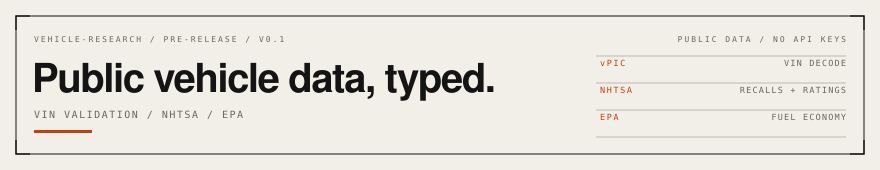

<picture>
  <source media="(prefers-color-scheme: dark)" srcset="assets/header-dark.svg">
  
</picture>

**Pre-release.** Not published to npm. The API may change before 1.0.

`vehicle-research` is a TypeScript client for the US public vehicle datasets. Give it a VIN and it decodes the vehicle, then fetches recalls, owner complaints, crash-test ratings, and fuel economy from the agencies that publish them. No API keys, no scraping, no commercial data.

It was extracted from VINly, an iOS app that uses the same sources. The product code stays private; this is the reusable layer.

## Why this exists

Several commercial vehicle APIs wrap the same three public datasets. This package calls the sources directly, keeps the response mapping in typed code, and returns `null` when a source is down instead of inventing a clean record. That distinction matters: "no recalls found" and "could not check" are different answers, and a safety product must not confuse them.

## Sources

| Source | Used for | Auth |
| --- | --- | --- |
| [NHTSA vPIC](https://vpic.nhtsa.dot.gov/api/) | VIN decode, makes, models, model years | None |
| [NHTSA](https://api.nhtsa.gov/) | Recall campaigns, owner complaints, investigations, NCAP ratings | None |
| [fueleconomy.gov](https://www.fueleconomy.gov/feg/ws/) | MPG, annual fuel cost, CO2, EV range, EPA specs | None |

All three are US federal services. Check each source's terms before commercial use; this package does not grant rights to the data.

## Install

The package is not on npm yet. Build from source:

```bash
git clone https://github.com/qadanm/vehicle-research.git
cd vehicle-research
npm install
npm run build
```

Once published, the install will be:

```bash
npm install vehicle-research
```

Requires Node 18 or later, or any runtime with `fetch`, `AbortController`, and `setTimeout`. There are no runtime dependencies.

## Quickstart

```ts
import { decodeVin, getRecallsDetailed } from 'vehicle-research';

const specs = await decodeVin('1HGCM82633A004352');
if (!specs?.year || !specs.make || !specs.model) {
  throw new Error('Could not decode that VIN');
}

const recalls = await getRecallsDetailed({
  year: specs.year,
  make: specs.make,
  model: specs.model,
});

console.log(`${specs.year} ${specs.make} ${specs.model}`);
console.log(recalls === null ? 'Recalls unavailable' : `${recalls.length} campaigns`);
```

The same flow is in [`examples/basic.mjs`](examples/basic.mjs) and is run against the built package:

```bash
npm run example
# 2003 Honda Accord EX-V6
# Recalls: 24 campaigns
```

## What you get

- **VIN validation.** 17-character format, the ISO 3779 check digit, WMI region classification, and OCR extraction that repairs common I/l and O/0 misreads. The check digit is only treated as authoritative for North American VINs, where manufacturers actually implement it.
- **VIN decode.** Extended vPIC decode: engine, displacement, horsepower, transmission, drivetrain, body, plant, airbags, seating, and factory driver-assistance fields.
- **Recalls.** Campaign number, component, summary, consequence, remedy, and date. The lookup tries multiple NHTSA model spellings rather than trusting one, because a rejected spelling and a genuine zero look identical.
- **Complaints.** Aggregated by component, with crash, fire, injury, and death tallies.
- **Investigations.** Whether the model appears in NHTSA's investigations list.
- **Safety ratings.** Overall, frontal, side, side-pole, and rollover stars, plus rollover probability and ADAS availability where NCAP publishes them.
- **Fuel economy.** City, highway, and combined MPG, annual fuel cost, CO2, passenger and luggage volume, EV range, and the EPA variant the numbers describe.
- **Vehicle lists.** Consumer makes, models by year, and model-year range.
- **Injected cache and timeouts.** No storage or framework assumptions.

## API

| Function | Returns |
| --- | --- |
| `decodeVin(vin)` | `VehicleSpecs \| null` |
| `getRecallsDetailed({ year, make, model })` | `RecallCampaign[] \| null` |
| `getComplaints({ year, make, model })` | `ComplaintSummary \| null` |
| `hasInvestigations({ year, make, model })` | `boolean \| null` |
| `getSafetyRatings(query)` | `SafetyRating \| null` |
| `getFuelEconomy(query)` | `FuelEconomy \| null` |
| `getEpaSpecs(query)` | `VehicleSpecs \| null` |
| `getMakes()` | `string[]` |
| `getModels(make, year)` | `string[]` |
| `getYears()` | `number[]` |
| `resolveNhtsaModel(issueType, query)` | `string` |
| `mergeSpecs(primary, fallback)` | `VehicleSpecs \| undefined` |

VIN helpers: `isVinFormat`, `isCheckDigitValid`, `computeCheckDigit`, `normalizeVin`, `wmiRegion`, `extractVins`, `pickBestVin`.

### `null` is not `[]`

This is the most important contract in the package:

- `[]` means the source answered and there is nothing on file.
- `null` means the source could not be reached or returned an unusable response.

Do not render `null` as "no recalls". A failed check is not a clean record.

## Configuration

The default cache is a per-process `Map`; pass a durable backend once at startup.

```ts
import { configureCache, type CacheBackend } from 'vehicle-research';

const cache: CacheBackend = {
  async get(key) {
    const raw = await redis.get(key);
    return raw ? JSON.parse(raw) : null;
  },
  async set(key, value, ttlSeconds) {
    await redis.set(key, JSON.stringify(value), 'EX', ttlSeconds);
  },
};

configureCache(cache);
```

Timeouts are configurable. The complaints endpoint is slower because some nameplates return multi-megabyte payloads.

```ts
import { configureHttp } from 'vehicle-research';

configureHttp({
  defaultTimeoutMs: 15_000,
  complaintsTimeoutMs: 30_000,
});
```

## Errors and limitations

- Network, timeout, and non-2xx responses resolve to `null`; the package does not throw for a failed source.
- US-market data only. NHTSA and EPA do not cover every global vehicle.
- The ISO 3779 check digit is authoritative for North American VINs. Elsewhere, position nine is often filler, so a failing digit is reported rather than treated as a bad read.
- Recalls are capped at 50 campaigns per vehicle.
- No listings, pricing, history reports, valuations, or auction data.
- Government APIs can be slow and rate-limited. Cache results; do not hammer them.
- This is not a substitute for a professional inspection or a manufacturer's service information.

## Testing

Deterministic tests use the response shapes confirmed against the live APIs. They do not call the network.

```bash
npm test        # 30 tests
npm run typecheck
npm run build
```

The opt-in integration check calls the real services:

```bash
npm run test:live   # 4 tests
```

CI runs the deterministic suite on Node 22 and 24. The live check is not part of CI because government APIs throttle.

## Versioning

Pre-1.0. Minor versions may change the API. Types and return semantics are treated as the contract; internal helpers are not exported.

## Contributing

See [CONTRIBUTING.md](CONTRIBUTING.md). Bug reports with a failing fixture are more useful than a general report. Do not include VINs that belong to other people.

## Security

See [SECURITY.md](SECURITY.md). Do not open a public issue for a vulnerability.

## License

No license is granted yet. MIT is the proposed license and is awaiting the owner's approval. Until a `LICENSE` file is added, no reuse rights are granted.

## Status

| | |
| --- | --- |
| Tests | 30 deterministic, 4 live |
| Runtime dependencies | 0 |
| Node | 18+ |
| Package name | `vehicle-research` (available on npm as of 2026-10-26) |
| Alternative scope | `@qadanm/vehicle-research` |
