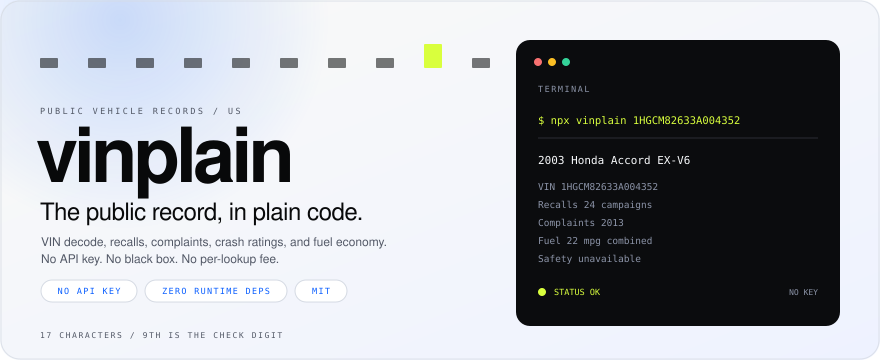

<picture>
  <source media="(prefers-color-scheme: dark)" srcset="assets/banner-dark.svg">
  
</picture>

<p align="center">
  <a href="https://www.npmjs.com/package/vinplain"></a>
  <a href="https://github.com/qadanm/vinplain/actions/workflows/ci.yml"></a>
  <a href="https://github.com/qadanm/vinplain/releases"></a>
  <a href="LICENSE"></a>
</p>

`vinplain` reads the public record for a VIN: the factory decode, recall campaigns, owner complaints, crash-test ratings, and fuel economy. It calls NHTSA's vPIC and safety APIs and the Department of Energy's fuel-economy API directly. It needs no API key and charges no per-lookup fee.

The package has no runtime dependencies. It runs on Node 18 or later, in browsers, and in edge runtimes that provide `fetch`.

Use it when you need the public record inside an app, a marketplace, or a test suite without putting a vendor account in the path.

## Install

```bash
npm install vinplain
```

Requires Node 18 or later, a browser, or an edge runtime with `fetch`. React Native and Expo need a `fetch` polyfill on older SDKs and a durable cache backend.

To work on the package:

```bash
git clone https://github.com/qadanm/vinplain.git
cd vinplain
npm install
npm run build
```

## Quickstart

```ts
import { getVehicleSummary } from 'vinplain';

const record = await getVehicleSummary({ vin: '1HGCM82633A004352' });

console.log(record.specs);            // 2003 Honda Accord EX-V6
console.log(record.recalls?.length);  // 24
console.log(record.status.recalls);   // 'ok'
```

`getVehicleSummary` decodes the VIN, then runs the record lookups in parallel. Each section resolves on its own, so a slow complaint database does not hold up the recall list.

## When a source fails

Every source can fail independently. The return values keep the difference between a failed request and an empty result:

- `null` means the request failed or the response was unusable.
- `[]` means the source answered and there is nothing on file.
- `getVehicleSummary` reports the same distinction in `status`, per section.

A failed recall check must not render as a clean record. The return types keep those cases separate.

## CLI

```bash
npx vinplain 1HGCM82633A004352
```

```text
2003 Honda Accord EX-V6
  VIN            1HGCM82633A004352
  Recalls        24 campaign(s)
  Complaints     2013 (158 crash, 19 fire, 157 injury, 1 death)
  Safety         overall n/a, frontal n/a, side n/a
  Fuel           22 mpg combined, $2900/year
  Investigations listed
```

Add `--json` for the full summary.

## What you get

| Capability | Detail |
| --- | --- |
| VIN validation | 17-character format, ISO 3779 check digit, WMI region, OCR extraction and single-character repair |
| VIN decode | Engine, displacement, horsepower, transmission, drivetrain, body, plant, airbags, seating, driver assistance |
| Recalls | Campaign number, component, summary, consequence, remedy, date |
| Complaints | Aggregated by component, with crash, fire, injury, and death tallies |
| Investigations | Whether the model appears in NHTSA's investigations list |
| Safety ratings | Overall, frontal, side, side-pole, rollover, rollover probability, ADAS availability |
| Fuel economy | City, highway, combined MPG, annual fuel cost, CO2, volumes, EV range, EPA variant |
| Vehicle lists | Consumer makes, models by year, model-year range |
| Cache and timeouts | Injectable backend and configurable timeouts, no framework assumptions |

## How it compares

| | vinplain | Offline VIN decoders | Paid history APIs |
| --- | --- | --- | --- |
| VIN decode | Yes | Yes | Yes |
| Recalls, complaints, NCAP, EPA | Yes | No | Varies |
| API key | None | None | Required |
| Cost | Free | Free | Per lookup or plan |
| History, auctions, valuations | No | No | Yes |

`vinplain` covers the public record. It does not sell history reports, and it does not ship an offline vehicle database.

## Sources

| Source | Used for | Auth |
| --- | --- | --- |
| [NHTSA vPIC](https://vpic.nhtsa.dot.gov/api/) | VIN decode, makes, models, years | None |
| [NHTSA](https://api.nhtsa.gov/) | Recalls, complaints, investigations, NCAP | None |
| [fueleconomy.gov](https://www.fueleconomy.gov/feg/ws/) | MPG, fuel cost, CO2, EV range | None |

All three are US federal services. Check each source's terms before commercial use. The package does not relicense their data.

## API

| Function | Returns |
| --- | --- |
| `getVehicleSummary({ vin })` | `VehicleSummary` with per-section status |
| `decodeVin(vin)` | `VehicleSpecs \| null` |
| `getRecallsDetailed({ year, make, model })` | `RecallCampaign[] \| null` |
| `getComplaints({ year, make, model })` | `ComplaintSummary \| null` |
| `hasInvestigations({ year, make, model })` | `boolean \| null` |
| `getSafetyRatings(query)` | `SafetyRating \| null` |
| `getFuelEconomy(query)` | `FuelEconomy \| null` |
| `getEpaSpecs(query)` | `VehicleSpecs \| null` |
| `getMakes()` / `getModels(make, year)` | `string[]` |
| `getYears()` | `number[]` |
| `mergeSpecs(primary, fallback)` | `VehicleSpecs \| undefined` |

VIN helpers: `isVinFormat`, `isCheckDigitValid`, `computeCheckDigit`, `normalizeVin`, `wmiRegion`, `extractVins`, `pickBestVin`.

## Cache and timeouts

The default cache is a per-process `Map`. Inject a durable backend once at startup:

```ts
import { configureCache, type CacheBackend } from 'vinplain';

const cache: CacheBackend = {
  async get(key) {
    const raw = await redis.get(key);
    return raw ? JSON.parse(raw) : null;
  },
  async set(key, value, ttlSeconds) {
    await redis.set(key, JSON.stringify(value), 'EX', ttlSeconds);
  },
};

configureCache(cache);
```

Complaint payloads can run to several megabytes, so that timeout is separate:

```ts
import { configureHttp } from 'vinplain';

configureHttp({
  defaultTimeoutMs: 15_000,
  complaintsTimeoutMs: 30_000,
});
```

## Docs

- [Getting started](docs/getting-started.md)
- [API reference](docs/api.md)
- [Failure model](docs/failure-model.md)
- [Data sources](docs/data-sources.md)
- [FAQ](docs/faq.md)
- [Market notes](docs/market.md)
- [Design notes](docs/design-notes.md)
- [Publishing](docs/PUBLISHING.md)
- [Contributing](CONTRIBUTING.md)
- [Security](SECURITY.md)

## Testing

```bash
npm test            # 34 deterministic tests
npm run test:live   # 4 live integration tests
npm run check       # typecheck + tests + build
```

The deterministic suite mocks `fetch` with response shapes confirmed against the live services. The live suite is opt-in because government APIs throttle.

## License

MIT. See [LICENSE](LICENSE).

## Status

| | |
| --- | --- |
| Version | 0.2.2 |
| npm | 0.2.2 |
| GitHub release | v0.2.2 |
| Runtime dependencies | 0 |
| Node | 18 or later |
| Tests | 34 deterministic, 4 live, 3 OCR |

Pre-1.0. Minor versions may change the API.
